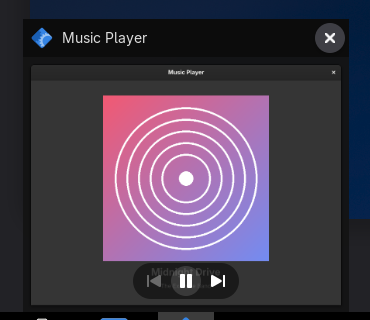
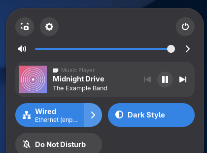

# Taskbar Media Controls

Windows-style media controls for GNOME Shell.

- **Taskbar hover previews:** previous / play-pause / next buttons on the window thumbnail when you hover a music app in [Dash to Panel](https://extensions.gnome.org/extension/1160/dash-to-panel/), like the Windows taskbar.
- **Quick Settings:** a media card with album art, title and artist right under the volume slider, like the media flyout next to the Windows volume panel.

It works with **any media player that supports MPRIS**, the standard Linux media-control interface: Spotify, Firefox, Chrome/Chromium, VLC, Rhythmbox, mpv (with `mpv-mpris`) and more. It never modifies the players themselves, so app updates (Spotify's included) don't break it.

<p>
  
  
</p>

**If this is useful to you, please ⭐ [star the repo](https://github.com/Jire/taskbar-media-controls) and [follow @Jire on GitHub](https://github.com/Jire) for more free tools like this.**

## Install

Paste the command for your distro into a terminal. Don't use `sudo`: it installs into your home folder.

**Arch Linux, Manjaro, EndeavourOS, CachyOS**

```bash
curl -fsSL https://raw.githubusercontent.com/Jire/taskbar-media-controls/main/install.sh | bash
```

**Fedora**

```bash
curl -fsSL https://raw.githubusercontent.com/Jire/taskbar-media-controls/main/install.sh | bash
```

**Ubuntu, Debian, Pop!_OS, Zorin OS** (uses `wget`, which these ship with by default)

```bash
wget -qO- https://raw.githubusercontent.com/Jire/taskbar-media-controls/main/install.sh | bash
```

Then **log out and back in**. GNOME on Wayland only loads newly installed extensions at login. On an X11 session you can instead press <kbd>Alt</kbd>+<kbd>F2</kbd>, type `r` and press <kbd>Enter</kbd>.

The installer downloads the latest release, installs it with `gnome-extensions`, enables it, and tells you if anything else is needed.

### Dash to Panel (optional)

The hover-preview buttons appear in Dash to Panel's window previews. The Quick Settings card works without it. Ubuntu's default dock doesn't show window previews, so on Ubuntu you'll want Dash to Panel for that part.

| Distro | Command |
| --- | --- |
| Arch-based | `sudo pacman -S gnome-shell-extension-dash-to-panel` |
| Fedora | `sudo dnf install gnome-shell-extension-dash-to-panel` |
| Ubuntu / Debian | `sudo apt install gnome-shell-extension-dash-to-panel` |
| Any | [extensions.gnome.org/extension/1160](https://extensions.gnome.org/extension/1160/dash-to-panel/) |

Distro packages can lag behind new GNOME releases. If yours doesn't support your GNOME version, use extensions.gnome.org.

### Load without logging out (Wayland)

GNOME's built-in Looking Glass console can load the extension into the running session:

1. Press <kbd>Alt</kbd>+<kbd>F2</kbd>, type `lg`, press <kbd>Enter</kbd>.
2. Paste this line into the prompt at the bottom and press <kbd>Enter</kbd>:

   ```js
   eval(new TextDecoder().decode(imports.gi.GLib.file_get_contents(imports.gi.GLib.get_user_data_dir() + '/gnome-shell/extensions/taskbar-media-controls@jire.github.io/hot-load.js')[1]))
   ```

3. Press <kbd>Esc</kbd>. A notification confirms it loaded.

This also works for reloading after an update. At your next normal login the regular installed copy loads as usual.

## Update

Run the install command again.

## Uninstall

```bash
curl -fsSL https://raw.githubusercontent.com/Jire/taskbar-media-controls/main/install.sh | bash -s -- --uninstall
```

(On Ubuntu/Debian, swap the start for `wget -qO- …`.) Or remove it from the **Extensions** app.

## Requirements

- GNOME Shell 46 to 51.
  - Developed and tested on GNOME 51 (Arch Linux, Wayland).
  - Versions 46 to 50 are supported in the code but haven't been tested yet. Please [open an issue](https://github.com/Jire/taskbar-media-controls/issues) if something looks wrong.
- Album art from streaming services (Spotify, browsers) is loaded over HTTPS through GVfs. GVfs is installed by default on GNOME desktops.

## How it works

- **[`mpris.js`](extension/mpris.js)** watches the session D-Bus for `org.mpris.MediaPlayer2.*` players and tracks each player's state and track info.
- **[`quickSettings.js`](extension/quickSettings.js)** inserts a card per active player (up to three, the playing one first) directly under the output-volume slider.
- **[`dashToPanel.js`](extension/dashToPanel.js)** wraps two methods of Dash to Panel's window-preview class to add a button bar to thumbnails of windows that belong to a media player. It matches by app first, then by process ID. Dash to Panel has no public API for this. If a future Dash to Panel release changes those methods, the hook switches itself off and logs a warning instead of breaking the panel.

Clicking the art or title in the Quick Settings card brings the player to the front. Clicking preview buttons controls playback without switching windows, and the preview stays open.

## Build from source

```bash
git clone https://github.com/Jire/taskbar-media-controls.git
cd taskbar-media-controls
scripts/build.sh                                   # creates dist/<uuid>.shell-extension.zip
./install.sh --zip dist/taskbar-media-controls@jire.github.io.shell-extension.zip
```

After changing code, rebuild, reinstall with `--zip`, and run the Looking Glass line above to reload without logging out.

## Troubleshooting

```bash
gnome-extensions info taskbar-media-controls@jire.github.io        # state and errors
journalctl --user -b _COMM=gnome-shell -g taskbar-media-controls  # warnings from the extension
busctl --user list | grep org.mpris.MediaPlayer2                   # players GNOME can see
```

If your player doesn't appear in that last list, it doesn't expose MPRIS, and no GNOME media controls (including the built-in ones) can see it.

## Support

This is free software, made in my spare time. The best ways to support it:

- ⭐ [Star the repo](https://github.com/Jire/taskbar-media-controls), which helps other people find it.
- 👤 [Follow @Jire on GitHub](https://github.com/Jire) to hear about more free tools like this.
- 🐛 [Report bugs or request features](https://github.com/Jire/taskbar-media-controls/issues), especially if you've tried it on a GNOME version other than 51.

## License

[GPL-2.0-or-later](LICENSE), the same license as GNOME Shell. Not affiliated with Microsoft, Spotify or the Dash to Panel project.
